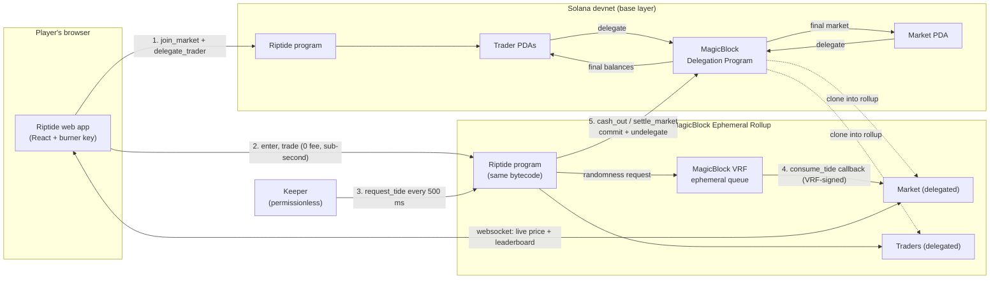

# 🌊 Riptide

**A real-time trading arena where the market is pure verifiable randomness, every trade is free, and every round settles on Solana.**

Riptide is an Entertainment Finance game built on MagicBlock. Each round opens a synthetic market whose price, "the tide", moves only when MagicBlock's VRF oracle delivers fresh randomness, one callback per tick, twice a second by default. Players join with 10,000 chips and go long or short with up to 5x leverage, and every trade executes inside a MagicBlock Ephemeral Rollup with zero fees and sub-second confirmations. Rare "riptide waves" hit the price by 3 to 8 percent in a single tick, wiped-out positions can be liquidated by anyone, and when the round ends each trader's final balance is committed back to Solana.

   

---

## The problem

Trading games are some of the most engaging things on a blockchain, but on a normal L1 they break in three places:

1. **Speed and cost.** A trading game needs dozens of actions per player per minute. At 400 ms blocks plus a fee and a wallet popup on every click, the game stops feeling like a game.
2. **Trust in the price.** Most "onchain" trading games run the price feed on a server. Players have to trust that the house isn't steering the chart against them.
3. **Fake ownership.** If the game state lives off-chain, the chips you "won" are an entry in someone's database.

## Our solution

Riptide puts the whole game onchain and still makes it feel instant:

| Problem | Riptide's answer |
| --- | --- |
| Speed and cost | The market and every trader account are delegated to a **MagicBlock Ephemeral Rollup**. Trades, liquidations and price ticks run there at **zero fees**, with sub-second confirmation. |
| Trust in the price | The price can **only** be changed by `consume_tide`, a callback that only **MagicBlock's VRF program** can sign. Each tick folds 32 bytes of verifiable randomness into the price. Nobody, including the round's creator, can move the chart. |
| Real ownership | Accounts start and end on **Solana**. Joining is a Solana transaction, and `cash_out` / `settle_market` commit the final state back to Solana and undelegate. |

---

## Sponsor technology at a glance

| Sponsor | Technology | Where Riptide uses it | Code |
| --- | --- | --- | --- |
| **MagicBlock** | Ephemeral Rollups: delegation | Market and trader PDAs are delegated to the rollup from Solana | [`delegate_market`](programs/riptide/src/lib.rs#L96), [`delegate_trader`](programs/riptide/src/lib.rs#L127) |
| **MagicBlock** | Ephemeral Rollups: zero-fee execution | All gameplay (`enter`, `trade`, `liquidate`, `request_tide`) runs on the rollup | [`trade`](programs/riptide/src/lib.rs#L222) |
| **MagicBlock** | Ephemeral Rollups: commit and undelegate | Live snapshots to Solana, then final settlement of every account | [`commit_market`](programs/riptide/src/lib.rs#L277), [`cash_out`](programs/riptide/src/lib.rs#L291), [`settle_market`](programs/riptide/src/lib.rs#L312) |
| **MagicBlock** | VRF (verifiable randomness) | The only source of price movement, requested and fulfilled inside the rollup | [`request_tide`](programs/riptide/src/lib.rs#L164), [`consume_tide`](programs/riptide/src/lib.rs#L189), [`tide.rs`](programs/riptide/src/tide.rs) |
| **MagicBlock** | MagicSVM | End-to-end tests that run Solana, the rollup and the VRF oracle in one process | [`tests-magicsvm-rs`](tests-magicsvm-rs/tests/riptide.rs) |
| **Solana** | Base layer and settlement | Round creation, joining, and where final balances live | [`create_market`](programs/riptide/src/lib.rs#L61), [`join_market`](programs/riptide/src/lib.rs#L110) |

---

## Architecture



### A round, step by step

1. **Create.** The round creator calls `create_market` on Solana (opening price 100.000, tick count and volatility are parameters) and `delegate_market` hands the market PDA to the rollup in the same transaction.
2. **Join.** A player's `join_market` creates their trader PDA with 10,000 chips, and `delegate_trader` moves it into the rollup. This is the only transaction that costs SOL.
3. **Enter.** On the rollup, `enter` adds the trader to the round's onchain roster, which powers the leaderboard.
4. **Tide.** The keeper calls `request_tide` on a timer. It is permissionless and does not touch the price; it only asks MagicBlock's VRF for randomness. The oracle answers with `consume_tide`, which is the only instruction that writes the price.
5. **Trade.** `trade(direction, notional)` closes any open position at the live price, realizes PnL, and opens a new long, short or flat position, enforcing 5x max leverage. Zero fees, so players can flip as often as they like.
6. **Liquidate.** When a position's equity hits zero, anyone can call `liquidate`. Losses are floored at the trader's chips.
7. **Settle.** After the last tick the round closes itself. `cash_out` closes the player's position and commits plus undelegates their account, so the final chip balance is back on Solana. `settle_market` does the same for the market.

### How the tide works

`tide::next_price` ([source](programs/riptide/src/tide.rs)) turns each 32-byte VRF output into one tick:

- Bytes 0 to 23 drive **six micro-steps**, each a uniform move of up to `volatility_bps` in either direction (0.4 percent by default).
- Byte 24 decides whether a **riptide wave** hits (6 in 256, about 2.3 percent of ticks), byte 25 its direction and byte 26 its size, from 3 to 8 percent.
- The price never drops below 1.0 chip, and the last 64 prices are stored onchain so the chart is read straight from program state.

Because the price is a pure function of VRF output, any tick can be re-derived from its randomness, which is stored in `Market.last_randomness` and in the callback logs.

---

## MagicBlock in detail

### Ephemeral Rollups: delegation

Both account types are delegated with the SDK's `#[delegate]` macro, which adds the buffer, delegation record and delegation metadata accounts, and generates the `delegate_market` / `delegate_trader` helpers. The client pins the rollup validator by passing its identity as a remaining account, so the market and every trader land on the same rollup.

```rust
#[delegate]
#[derive(Accounts)]
#[instruction(round_id: u64)]
pub struct DelegateMarket<'info> {
    #[account(mut)]
    pub authority: Signer<'info>,
    /// CHECK: the market PDA being delegated
    #[account(mut, del, seeds = [MARKET_SEED, authority.key().as_ref(), &round_id.to_le_bytes()], bump)]
    pub market: UncheckedAccount<'info>,
}
```

Joining and delegating happen in one Solana transaction from the client ([`RiptideClient.join`](client/riptide.ts)).

### Ephemeral Rollups: zero-fee, real-time gameplay

The program module is marked `#[ephemeral]`, so the same bytecode serves both layers and the rollup can hand accounts back. Everything players touch during a round runs on the rollup: `enter`, `trade`, `liquidate`, `request_tide` and the VRF callback. The web app sends those transactions straight to the rollup RPC, subscribes to the market account over the rollup's websocket for live price and leaderboard updates, and shows the measured confirmation time of each trade next to the fee, which is 0.

### Ephemeral Rollups: commit and undelegate

Riptide uses the SDK's `MagicIntentBundleBuilder` in three places:

- `commit_market`: snapshot the live market to Solana without leaving the rollup (`.commit`).
- `cash_out`: close the player's position at the live price, then `.commit_and_undelegate` the trader account so their final chips are owned by the Riptide program on Solana again.
- `settle_market`: once the round is closed, `.commit_and_undelegate` the market.

The end-to-end test checks that after settlement the Solana copy of each account matches the rollup copy exactly.

### VRF: the only thing that moves the market

`request_tide` builds a scoped randomness request with `create_request_scoped_randomness_ix`, sent to MagicBlock's **ephemeral oracle queue** so it is fulfilled inside the rollup. The callback, `consume_tide`, uses the `#[vrf_callback]` macro, which requires the VRF program's identity to sign. That is what makes the price trustworthy: there is no admin "set price" instruction, and the keeper can only ask for randomness, never choose it.

```rust
let ix = create_request_scoped_randomness_ix(RequestRandomnessParams {
    payer: ctx.accounts.payer.key(),
    oracle_queue: ctx.accounts.oracle_queue.key(),
    callback_program_id: ID,
    callback_discriminator: instruction::ConsumeTide::DISCRIMINATOR.to_vec(),
    caller_seed: [client_seed; 32],
    accounts_metas: Some(vec![SerializableAccountMeta {
        pubkey: ctx.accounts.market.key(), is_signer: false, is_writable: true,
    }]),
    callback_args: Some(vec![client_seed]),
    ..Default::default()
});
ctx.accounts.invoke_signed_vrf(&ctx.accounts.payer.to_account_info(), &ix)?;
```

### MagicSVM: testing the whole stack in one process

`tests-magicsvm-rs` runs Solana, an Ephemeral Rollup and the VRF oracle together with MagicBlock's MagicSVM, so the tests exercise the real delegation, randomness and settlement flow rather than mocks:

| Test | What it proves |
| --- | --- |
| `vrf_moves_the_tide_and_closes_the_round` | Each VRF callback advances exactly one tick, writes history, moves the price, and the round closes itself at `max_ticks` and refuses further requests. |
| `full_round_trades_on_the_rollup_and_settles_on_solana` | Two traders delegate, enter and trade opposite sides on the rollup; leverage limits and ownership checks hold; PnL is exact and mirrored; `close_round` stops trading; `cash_out` and `settle_market` land the exact final state on Solana. |
| `wiped_out_positions_can_be_liquidated_by_anyone` | In a stormy market, one side of a max-leverage long/short pair is wiped out and a stranger liquidates it; healthy positions cannot be liquidated. |

The price math in `tide.rs` also has unit tests for the volatility band, wave size and direction, the price floor, PnL symmetry and the balance of the random walk.

---

## Repository tour

```
programs/riptide/        Anchor program (Rust)
  src/lib.rs             instructions, accounts, delegation, VRF, settlement
  src/tide.rs            pure price math, unit-tested
tests-magicsvm-rs/       end-to-end tests on MagicSVM (Solana + rollup + VRF)
client/
  riptide.ts             TypeScript client: PDAs, tx builders, decoding, live subscriptions
  cli.ts                 create, inspect and settle rounds
  keeper.ts              requests a tide every 500 ms and liquidates wiped-out traders
  bots.ts                momentum, contrarian and random demo traders
app/                     React web app (price chart, trading desk, leaderboard)
scripts/deploy-devnet.sh one-command devnet deploy and round start
demo/script.md           demo video storyboard and narration
test-utils/              MagicSVM helpers from MagicBlock's MIT-licensed examples
```

## Run it

### Tests (no network needed)

```bash
npm install
cargo build-sbf --manifest-path programs/riptide/Cargo.toml
anchor idl build -p riptide -o target/idl/riptide.json
npm test
```

### Devnet

You need the Solana CLI, a devnet wallet at `~/.config/solana/id.json` with about 4 devnet SOL, and Node 20 or newer.

```bash
./scripts/deploy-devnet.sh      # deploys the program and opens a 600-tick round
npm run keeper                   # keeps the tide moving
npm run bots -- "" 4             # optional: four demo traders
npm run dev                      # open the URL it prints, with ?market=<address>
```

The app creates a burner key in the browser, so there are no wallet popups. Joining needs one Solana transaction, so fund the burner with devnet SOL from [faucet.solana.com](https://faucet.solana.com/) (the public RPC airdrop endpoint is closed); after that, every trade is free.

Endpoints default to Solana devnet and MagicBlock's Asia devnet rollup (`devnet-as.magicblock.app`). Override them with `RIPTIDE_BASE_RPC`, `RIPTIDE_ER_RPC`, `RIPTIDE_ER_VALIDATOR` and `RIPTIDE_ORACLE_QUEUE` for the CLI, or `VITE_BASE_RPC` and `VITE_ER_RPC` for the app.

---

## What's next

- **Private positions** with MagicBlock's Private Ephemeral Rollups, so nobody can copy-trade or hunt your liquidation price until the round settles.
- **Onchain keeper** using MagicBlock's scheduled cranks, so the tide ticks without any off-chain process.
- **Real stakes**: entry fees in USDC escrowed on Solana, with the prize pool paid out by final rank at settlement.
- **Session keys** for players who want to trade from their main wallet without popups.
